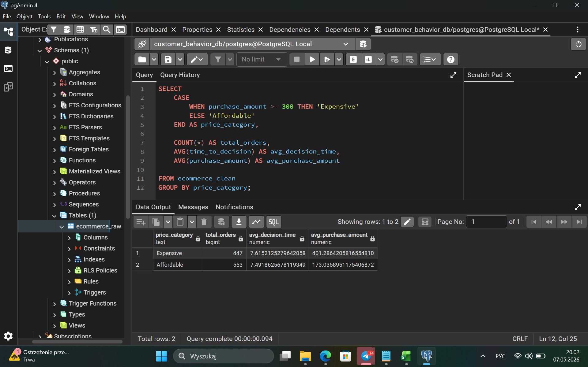
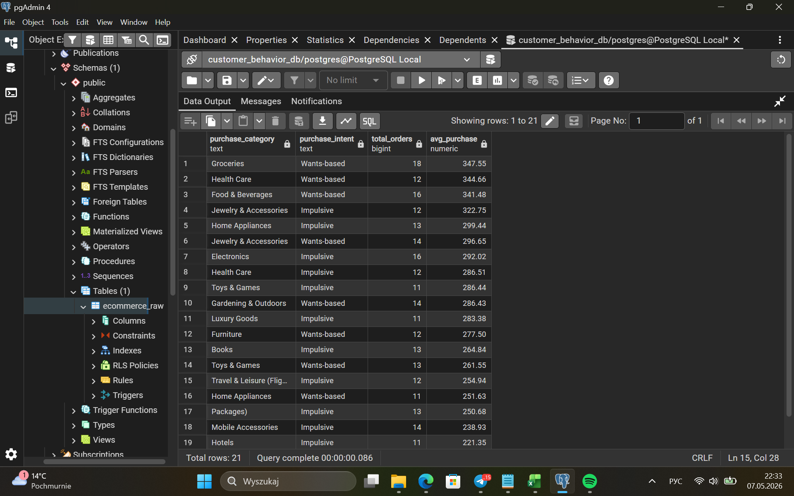
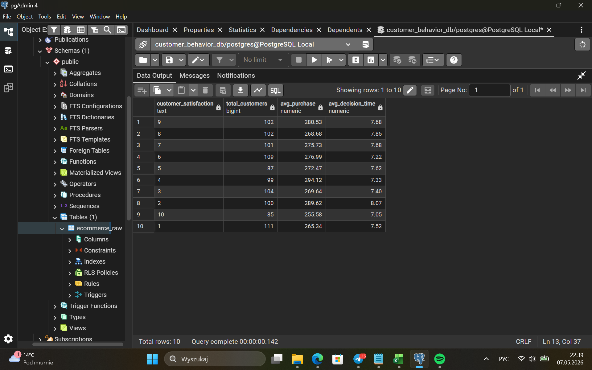
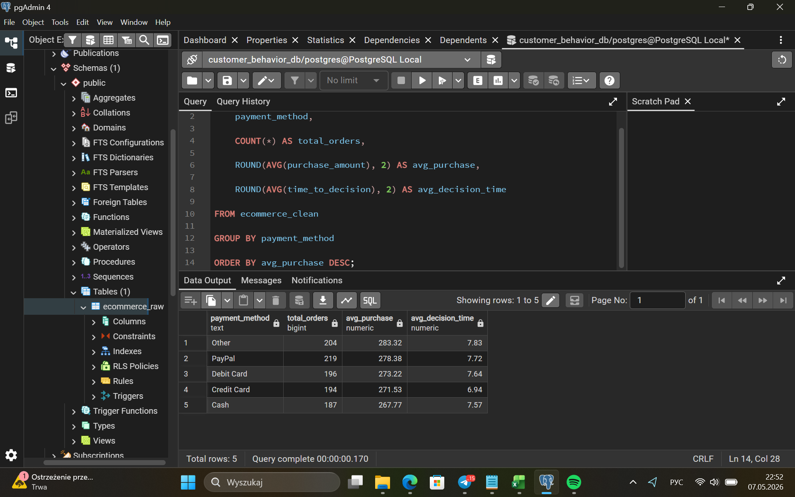

# 🛒 Consumer Behavior SQL Analysis

## Project Overview

This project analyzes ecommerce customer behavior using **PostgreSQL**.

The goal was to explore how factors such as **income, discounts, emotions, customer satisfaction, social media influence, loyalty, and payment methods** relate to purchasing behavior.

Instead of focusing only on SQL queries, I approached the dataset from a business perspective by defining analytical questions, cleaning the data, performing SQL analysis, and translating the results into business insights.

---

## Business Questions

The analysis focuses on several questions:

1. Do higher-income customers make more expensive purchases?
2. Are customers influenced by discounts more likely to make impulsive purchases?
3. Do loyal customers spend more?
4. How does social media influence purchasing behavior?
5. Which product categories are associated with emotional purchases?
6. Is customer satisfaction related to spending?
7. Which payment methods are most commonly used?
8. What customer behavior patterns could be useful for ecommerce decision-making?

---

## Analytical Workflow

The project followed a simple analytical process:

**Business Questions → Data Cleaning → SQL Analysis → Results → Business Insights**

### 1. Data Cleaning

Before performing the analysis, the dataset was reviewed and prepared in PostgreSQL.

The cleaning process included:

- checking for missing values;
- reviewing data types;
- identifying duplicate records;
- validating numerical fields;
- preparing variables for analysis.

The cleaning queries are available here:

[`cleaning.sql`](SQL/cleaning.sql)

### 2. SQL Analysis

The main analysis was performed using PostgreSQL.

SQL techniques used in the project include:

- `SELECT`
- `WHERE`
- `GROUP BY`
- `ORDER BY`
- `CASE WHEN`
- aggregate functions
- `COUNT()`
- `AVG()`
- `SUM()`
- conditional analysis
- customer segmentation

Full analysis:

[`analysis_queries.sql`](SQL/analysis_queries.sql)

---

# Analysis Highlights

## 1. Expensive vs Affordable Purchases

This analysis compares purchasing patterns across different customer groups and explores differences between more expensive and more affordable purchases.



The comparison helps identify whether customer characteristics and purchasing behavior differ depending on purchase value.

---

## 2. Emotional Purchases

Customer purchasing behavior was also analyzed from the perspective of emotional buying.



This analysis helps identify product categories and customer groups where emotional factors may play a stronger role in purchasing decisions.

---

## 3. Customer Satisfaction

The relationship between customer satisfaction and purchasing behavior was explored to understand whether more satisfied customers demonstrate different spending patterns.



Customer satisfaction can be an important indicator when analyzing retention, loyalty, and long-term customer value.

---

## 4. Payment Methods

Payment preferences were analyzed to identify the methods most commonly used by customers.



Understanding payment preferences can help ecommerce businesses improve the checkout experience and reduce unnecessary friction during the purchase process.

---

# Key Business Insights

The analysis suggests several patterns in customer behavior:

- Purchasing decisions are influenced by more than customer income alone.
- Discounts can play an important role in purchasing behavior, particularly for customers who are more price-sensitive.
- Emotional factors may influence purchasing decisions differently across product categories.
- Customer satisfaction should be considered together with spending and loyalty when evaluating customer value.
- Payment preferences provide useful information for optimizing the ecommerce checkout experience.
- Behavioral variables can provide additional context that traditional demographic segmentation may not capture.

More detailed observations are available in:

[`business_insights.md`](insights/business_insights.md)

---

# Business Recommendations

Based on the analysis, several actions could be explored:

**1. Improve customer segmentation**

Combine demographic information with behavioral characteristics such as discount sensitivity, loyalty, emotional purchasing, and social media influence.

**2. Use discounts more strategically**

Instead of applying promotions equally to all customers, focus discounts on customer groups that demonstrate stronger price sensitivity.

**3. Monitor customer satisfaction**

Customer satisfaction should be tracked together with purchasing behavior to identify customers with strong long-term value potential.

**4. Optimize the checkout experience**

Frequently used payment methods should remain easy to access and frictionless during checkout.

**5. Use behavioral data for personalized marketing**

Behavioral patterns can support more targeted campaigns and product recommendations.

---

# Tools & Technologies

- **PostgreSQL**
- **SQL**
- **pgAdmin**
- **GitHub**
- **Markdown**

---

# Skills Demonstrated

- SQL querying
- Data cleaning
- Data aggregation
- Customer segmentation
- Exploratory data analysis
- Business-oriented analysis
- Translating data into actionable insights
- Communicating analytical results

---

# Project Structure

```text
ecommerce-customer-behavior-analysis/
│
├── README.md
│
├── SQL/
│   ├── cleaning.sql
│   └── analysis_queries.sql
│
├── insights/
│   └── business_insights.md
│
└── screenshots/
    ├── customer_satisfaction_analysis.png
    ├── emotional_purchases_analysis.png
    ├── expensive_vs_affordable.png
    └── payment_methods_analysis.png
```

---

## About This Project

This project was created as part of my **Data Analytics portfolio**.

The main objective was to practice using SQL not only to retrieve data, but also to answer business questions and transform query results into understandable business insights.
